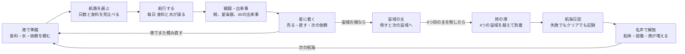

# 星間航海ゲーム 企画書（るぱ・新作）

2026-11-18

## 概要とタイトル案

お腹をすかせた乗組員を乗せた払い下げの戦艦で、紙の星図をたどって星海の果ての港を目指す、ローグライト型の航海シミュレーションです。戦艦の改造、星での買い出しとクエスト、航路上の賊やモンスターとの戦闘を、1回60〜90分の航海にまとめます。

| 項目 | 決定 |
| --- | --- |
| ジャンル | ローグライト航海シミュレーション（指揮型リアルタイム戦闘） |
| 一言コンセプト | 砲を積むか、パンを積むか。船倉ひとつでやりくりする星間航海 |
| 1プレイ | 1航海 60〜90分。失敗するとその航海は終わり、次の航海に解放要素を持ち越す |
| 全体の遊べる量 | 初クリアまで 4〜6時間、全要素の解放まで 10〜12時間 |
| 想定価格 | 1,000円前後 |
| 難易度 | 選択式（やさしい / ふつう / 歯ごたえあり）＋クリア後に「航海難度」1〜10 |
| 操作 | マウス中心＋キーボードのショートカット（スペースで一時停止） |
| 持ち帰ってほしい感情 | 「生きて港に着いた」という安堵と、「次はもっとうまくやりくりできる」という手応え |

**タイトル案**（おすすめは1）

1. **腹ぺこ戦艦、星海をゆく** — 「戦艦」と「食料」という2つの柱がタイトルだけで伝わり、DLsiteの一覧で目に留まりやすい
2. **星海航路図** — 落ち着いた航海図の雰囲気を前に出す案
3. **ステラ・ログブック** — 航海日誌が残っていく周回の仕組みを前に出す案

## この作品だけの売り：船倉はひとつ

戦艦の中はマス目の「船倉」になっていて、砲・装甲・機関といった装備も、食料や水も、依頼の荷物も、すべて同じマスの取り合いです。この作品の中心は、この一つのやりくりです。

- **空間の取り合い**：主砲を2門にすれば、水樽を置く場所が減る。高額の荷物を受ければ、食料を削ることになる
- **重さの取り合い**：積むほど艦は重くなり遅くなる。遅いと航海の日数が増え、食料も水も多く要る。賊から逃げることも難しくなる
- **戦闘で壊れるのも船倉**：敵の弾はマスに当たる。食料庫に当たれば食料が減り、荷物に当たれば報酬が減る。どこに何を置くかがそのまま守りになる

買う人には、「砲を積むか、パンを積むか。」という一言と、船倉の断面図のスクリーンショット1枚で伝えます。過去作の「灯火の迷宮」「ルミナス・ナイト」は自分で動かすアクションでしたが、今回は「考えて並べ、指示を出す」遊びで、買ってくれた人にも別の楽しさを出せます。

## 世界観

宇宙を「星海（ほしうみ）」と呼ぶ世界で、航海士たちは今も紙の星図を頼りに航路を引きます。主人公は、退役した古い戦艦を払い下げで手に入れた新米艦長です。

- **目的**：星海の果てにあるという伝説の港「終の港（ついのみなと）」まで、白紙の星図を届ける。行って帰った者のいない航路なので、航海のたびに星の並びが変わる（毎回地図が自動生成される理由）
- **口当たり**：死や流血は描かず、「力尽きる」「航行不能」という表現にする。乗組員は腹をすかせ、文句を言い、おいしい飯で元気になる。緊張感のある航海と、港の食堂ののんびりした空気を交互に出す
- **賊**：星海の航路を縄張りにする賊の一家が各宙域にいて、それぞれ狙うもの（荷物、食料、艦そのもの）が違う
- **モンスター**：星海に棲む「星海獣（ほしうみけもの）」。食料の匂いに寄ってくるもの、艦の金属をかじるものなどがいて、倒すと食べられる素材を落とすものもいる

## 1航海の流れ

1航海は4つの宙域を通り、1宙域あたり星3〜5つを経由します。港で積んで、航路で減って、戦って取り返す、をくり返しながら奥へ進むのが基本の流れです。



航路の途中で乗組員全員が力尽きるか、戦闘で艦が航行不能になると、その航海は終わり航海日誌に飛びます。最初の出航から30秒以内に小さな賊との戦闘を入れ、説明を読まなくても気持ちよい瞬間にたどり着けるようにします。

## 戦闘：一時停止できる指揮型リアルタイム

画面の左に自分の艦の断面図、右に敵を並べ、時間は流れるがスペースキーでいつでも止められます。止めている間に指示を出し、動かして結果を見る、をくり返します。1戦は30秒〜2分が目安です。

**艦長が出せる指示**

- **照準**：武器ごとに、敵のどの部位を狙うか選ぶ（砲を潰すか、機関を止めて逃げられなくするか、賊の船倉を狙って後で拾える戦利品を残すか）
- **距離**：「近・中・遠」の3段階。武器には得意な距離があり、速い方が距離を取りやすい。ここで「スピード」が戦闘にも効く
- **乗組員の配置**：人がついた装備は効率が上がる。壊れたマスの修理、火の消し止め、乗り込んできた賊の追い返しも乗組員の仕事
- **退却**：機関の出力と重さで決まる「逃走ゲージ」がたまれば逃げられる。荷物を捨てて軽くすると、ゲージが速くたまる

**気持ちよさの作り方**：砲撃のための溜め、発射の反動で艦が揺れる動き、命中したマスが破れた紙のように裂ける演出、撃破時に戦利品が船倉に転がり込む音、をそれぞれ入れます。参考にするのは仕組みだけで、画面と名前はすべて独自のものにします。

## 艦のカスタマイズ

艦の強さは、「船体」を選び、その船倉のマスに「装備」をパズルのように置いて決めます。数字を直接振るのではなく、何をどこに置いたかの結果として能力が決まります。

| 能力 | 何で決まるか | 足りないとどうなるか |
| --- | --- | --- |
| 積載量 | 船倉の空きマスと「倉庫」装備（積み重ねできるマス） | 食料も荷物も少ししか載せられない |
| スピード | 機関の出力 ÷ 艦全体の重さ | 航海の日数が増え、逃げられず、戦闘で距離を取られる |
| 頑丈さ | 船体の耐久、装甲板、シールド発生機 | 戦闘で装備や食料庫がすぐ壊れる |
| 攻撃力 | 主砲・副砲・魚雷などの武器と、配置した乗組員 | 戦闘が長引き、その分壊される |
| 生活力 | 調理室・浄水機・菜園・医務室 | 食料と水の減りが速く、士気が落ちる |

- **船体**：形とマス数、基本の重さが違う。細長く速い巡航艦、幅広で積める輸送艦、分厚い戦艦など
- **装備の形**：1マスの小物からL字型や横長の大物まで。隣り合うと効果が上がる組み合わせ（砲の隣に弾薬庫、調理室の隣に食料庫など）を用意し、「どう並べるか」を考える余地を作る
- **改造できる場所**：工業の星のドックでは自由に並べ替え、航海中は荷物と食料の並べ替えだけできる

## 食料・水と乗組員

乗組員は1人につき1日に食料1つと水1つを消費し、乗組員が多いほど艦は強くなりますが大食いになります。「何人乗せて、何日分積むか」を港ごとに決めるのが、この作品の買い出しです。

- **尽きたときの段階**：どちらかが尽きると「空腹」（士気と装備の効率が下がる）→2日で「衰弱」（乗組員が1人ずつ力尽きて寝込む）→全員寝込むと航海失敗。寝込んだ乗組員は次の港で復帰できるので、理不尽な即死は起きない
- **届かないと先に分かる**：航路を選ぶときに「到着までの日数」と「残りの食料で何日もつか」を並べて表示し、足りないと紙に朱印が押される
- **食料の種類**：安くて重い保存食、士気が上がるが日がたつと傷む生鮮品、モンスターから取れる「星海獣の肉」。水は重いので、浄水機を積むかどうかが悩みどころになる
- **料理**：調理室があれば、食材の組み合わせで料理を作れる。「次の戦闘で砲の装填が速い」などの効果がつき、星ごとの名物料理もある
- **乗組員の職**：砲手、機関士、修理工、コック、航海士、術士（医務）の6職。港の酒場で雇い、名前と口癖がある。航海を越えては残らないが、周回で「なじみの乗組員」が増える

## 星とクエスト

星には8種類の港があり、それぞれ安く買えるものと受けられる依頼が違います。農業の星では食料が安く、氷の星では水が安く、工業の星では改造ができる、といった形で、どの星を経由するかが作戦になります。

港の施設は「市場（食料・水・交易品）」「ドック（改造・修理）」「酒場（乗組員・噂話）」「組合の掲示板（クエスト）」の4つで、どの港にも全部あるわけではありません。

| クエスト | 内容 | 船倉への影響 |
| --- | --- | --- |
| 荷物運び | 期限までに別の星へ届ける。壊れ物、生もの、大きいものなど、荷ごとに癖がある | 荷物がマスを占め、重くなる |
| 賊の討伐 | 手配書の賊がいる航路を通り、戦って倒す | 戦利品を積む場所が要る |
| 護衛 | 商船を連れて航路を行く。商船は遅く、戦闘では商船も狙われる | なし（ただし日数が増え食料が減る） |
| 星海獣の狩り | 指定のモンスターを倒し、素材を持ち帰る | 素材がマスを占める |
| 漂流船の救助 | 航路の外れにいる船を探し、人を拾う | 救った人も食べる |
| 届け物の料理 | 指定の料理を作って届ける | 調理室と食材が要る |

報酬はお金、「名声」（周回で使う）、珍しい装備の3種類です。依頼を欲張って重ね受けすると船倉が満杯になり、食料が積めなくなる、という自業自得の失敗が起きるようにします。

## 賊とモンスター

賊は「船倉の中身を奪う」敵、モンスターは「艦そのものや食料を荒らす」敵として、対処の仕方をはっきり分けます。賊8種、モンスター8種、ボス5体で、1体ごとに「こいつにはこうする」が違うようにします。以下は代表例です。

| 敵 | 種類 | やってくること | 対処 |
| --- | --- | --- | --- |
| 掃き寄せの小舟 | 賊 | 群れで来て荷物をひっかけて逃げる | 副砲でまとめて落とす |
| 鉤爪船 | 賊 | 接近して乗り込み、船倉で暴れる | 距離を取る、乗組員で追い返す |
| 金庫破り | 賊 | こちらの船倉を狙い、一番高い荷を射抜く | 高い荷を装甲の奥に置く |
| 大食いクジラ | モンスター | 食料庫に食らいつき、食料を飲み込む | 食料を捨てて気をそらすか、倒して肉を取り返す |
| 鉄かじり虫 | モンスター | 船体に張りつき、装甲を少しずつ削る | 修理工で剥がす |
| 星潮クラゲ | モンスター | 電気で機関を止める | シールドを機関側に向ける |
| 各宙域の主（4体）＋最後の番人（1体） | ボス | 大きな身体にいくつもの部位があり、壊す順番で攻め方が変わる | 宙域ごとの準備が試される |

航路上には敵以外にも、彗星の尾の嵐、漂流する物資、商人船との出会いといった「星海イベント」が40種類あり、選択で食料や乗組員が増えたり減ったりします。

## 成長と周回

航海中の成長は「お金で装備を買い、船倉を組み替える」ことで、航海をまたいでの成長は「名声で選択肢を増やす」ことです。周回で艦の数字が強くなりすぎないようにし、先に進める理由は「上達」と「新しい組み合わせ」に置きます。

- **航海日誌**：航海が終わると、通った星、倒した敵、積んだ荷、力尽きた理由が日誌の1ページになる。失敗しても「次はこうする」が一目で分かる
- **名声で解放するもの**：新しい船体（最初1隻→6隻）、店に並ぶ装備、港の種類、なじみの乗組員、出航時の特典（「保存食が多め」など）
- **クリア後**：航海難度1〜10を順に開放。難度ごとに「食料が高い」「賊が多い」などの条件が重なる。すべての船体でクリアすると、終の港の本当の姿が分かる結末を見られる
- **実績**：30個。「食料を一度も切らさずにクリア」「主砲なしでクリア」など、遊び方を変えるきっかけになるものを中心にする

## 見た目の方向：古い航海図

宇宙を「生成りの紙に墨で描いた航海図」として見せ、暗い背景も発光も使いません。星海ゲームの平均的な見た目（黒い宇宙に光る星）とは真逆なので、サムネイルに並んだときに一目で区別がつきます。

| 要素 | 決定 |
| --- | --- |
| 背景の色 | 生成りの紙色（少し黄ばんだ白）。紙のしわ、折り目、うっすらした染みを重ねる |
| 線の色 | セピア寄りの墨色。航路は破線、通った航路は実線で描き足されていく |
| 主役の色 | 緑青（ろくしょう、くすんだ青緑）。自分の艦と味方のもの |
| 差し色 | 朱（しゅ）を敵と危険に、金茶をお金と報酬に。色の意味はこの3つだけにしぼる |
| 星 | 光る点ではなく、羅針盤のような刻印。港の種類ごとに紋章の形が違う |
| 艦 | 横から見た断面図。細い斜線の影（ハッチング）で立体感を出す。被弾すると紙が破れ、焦げ跡が残る |
| 乗組員 | 判子のような2.5頭身。職ごとに帽子や道具のシルエットが大きく違い、影だけで職が分かる |
| モンスター | 古地図の余白に描かれる怪物のような、曲線の多い版画風 |
| UI | 紙の札、背表紙のような帳簿、蝋封のボタン。角は丸めず、切符のような切り欠きにする。選んだものには印鑑が押される |
| 文字 | 見出しは明朝体（Zen Old Mincho）、本文と数字は読みやすいゴシック体（BIZ UDPゴシック）。どちらも商用可のフリーフォント |

気になる点として、「紙なので宇宙らしくない」と感じる人もいるはずです。そこで戦闘画面だけは、航海図の上に「大きく描き込まれた挿絵」という構図にし、砲撃の閃光などの動きで迫力を出します。

## 収録内容の量

1,000円前後で「薄い」と感じさせない量として、次の数を約束します。減らす場合は黙って減らさず、理由と一緒に報告します。

| 項目 | 数 | 内訳・補足 |
| --- | --- | --- |
| 宙域 | 6 | 1航海で通るのは4つ。第2・第3宙域は分かれ道で選ぶ |
| 港の種類 | 8 | 農業・氷・工業・交易・賊の隠れ港・遺跡・巡礼・闇市 |
| 船体 | 6 | 最初は1隻、名声で解放 |
| 装備 | 36 | 武器12・防御6・機関4・生活8・特殊6 |
| 賊 | 8 |  |
| モンスター | 8 |  |
| ボス | 5 | 宙域の主4＋最後の番人1 |
| クエストの種類 | 6 | 荷物の癖や期限の違いで、実際の依頼はそれより多く見える |
| 星海イベント | 40 | 航路上で起きる選択型の出来事 |
| 食材・料理 | 食材8・料理20 | 星ごとの名物料理を含む |
| 乗組員の職 | 6 | なじみの乗組員（名前つき）12人 |
| 実績 | 30 |  |
| 航海難度 | 10段階 | クリア後に開放 |
| BGM | 8曲 | タイトル、港、航海、戦闘、ボス、結末など |
| 遊べる時間 | 初クリア4〜6時間、全解放10〜12時間 | 自動プレイと自分のプレイで確かめる |

## 技術・仕様

過去作と同じ HTML5 ＋ JavaScript で作り、Electron で Windows 用の exe にまとめます。過去作で動作実績があり、自動プレイでのバランス確認も同じコードで回せるのが理由です。

- **動作環境**：Windows 10 / 11（64bit）。zip を解凍して exe をダブルクリックするだけ。通信なし
- **画面**：1280×720 基準、ウィンドウとフルスクリーンの切替
- **操作**：マウスだけで全部遊べる。一時停止、武器の発射、距離の変更にはキーボードのショートカットを用意。ゲームパッドは対応しない（マスに置く操作が主なため）
- **絵と音**：絵はすべてコードで描画（紙の質感も生成）、効果音とBGMもコードで生成。フォントは商用可のフリーフォントを同梱し、ライセンスを一覧にする
- **セーブ**：港に着いたときと航海の区切りで自動保存。途中でやめても続きから遊べる
- **体験版**：第1宙域の主を倒すまで（約20〜30分）。解放状況は製品版に引き継げる

## マイルストーン

確認のために止まるのは、この企画書と試作版の2回だけです。試作版にOKが出たら、完成まで止まらずに進めます。

1. **企画書**（この文書）— ここで一度止まり、返事を待つ
2. **試作版** — 宙域1つ（星4つ）、船体1隻、装備10種、賊2種＋モンスター1種、クエスト2種（荷物運び・討伐）、食料と水の消費。「船倉を組んで、出航して、賊と戦って、港で稼ぐ」を1周、手触りと見た目まで磨く — ここで一度止まり、感想を待つ
3. **仕組みの完成** — 全クエスト6種、料理、乗組員の職、交易、一航海の最初から最後まで。自動プレイのボット3種（下手・普通・上手）を用意
4. **量の実装** — 宙域6、港8種、装備36、敵と21体、イベント40、料理20
5. **周回とボス** — 名声と解放、航海日誌、航海難度、実績、ボス5体、結末
6. **仕上げ** — 演出・音・BGM、タイトル・設定・ポーズ・クレジット、バランスの詰め、品質基準の自己採点
7. **製品化** — exe 一式の zip、readme.txt、体験版、DLsite 用の画像と紹介文、Ci-en 記事と告知文

## 一番難しい所と確かめ方

一番難しいのは、「食料・重さ・速さ・日数」のつながりを、悩ましいけれど理不尽ではない強さに合わせることです。甘ければ「とりあえず大量に買う」だけの作業になり、厳しければ「知らないうちに餓えていた」という不満になります。

- **自動プレイで数字を見る**：3種類のボットで各500航海を回し、「何で力尽きたか」の割合を出す。普通のボットで「食料切れによる失敗」が全失敗の2〜3割、上手なボットでは1割未満になるのを目標にする（上手い人ほど餓えない＝上達で解決できる問題になっている）
- **「たくさん買う」が正解になっていないか**：食料を最大まで積むだけのボットを作り、それが普通のボットより明らかに稼ぎもクリア率も低いことを確かめる
- **初めての人の最初の1分**：タイトルから最初の港、出航、30秒以内に小さな賊との戦闘、主砲で撃ち抜く気持ちよさ、戦利品の食料箱が船倉に転がり込む、という流れを画面写真と動画で確かめ、説明を読まなくても進めるかを別のレビュー役に遊ばせて判断する
- **戦闘が読めるか**：紙の画面で敵の攻撃や壊れたマスが一目で分かるかを、実際の画面写真を縮小して確かめる

## 確認したいことと返事の形

試作版に進む前に、次の3つを教えてください。説明書とクレジットに載せるため、空欄のままでは納品できません。

- 作者名
- 連絡先（X、Ci-en の URL、問い合わせ用アドレスなど）
- 締め切りがあればその日付

以下はこちらで決めました。違う場合だけ「変えたい点」に書いてください。

- タイトルは「腹ぺこ戦艦、星海をゆく」
- 乗組員は名前と口癖があるが、立ち絵や会話シーンは入れない（量を航海の部分に割く）
- ゲームパッドは対応しない
- 絵と音はすべてコードで作る

```
企画書を読みました。次の点を反映して、試作版を作ってください。
- 作者名：【 】
- 連絡先：【 】
- 締め切り：【 / なし】
- 変えたい点：【 / なし】
- 特に期待している点：【 】
```
